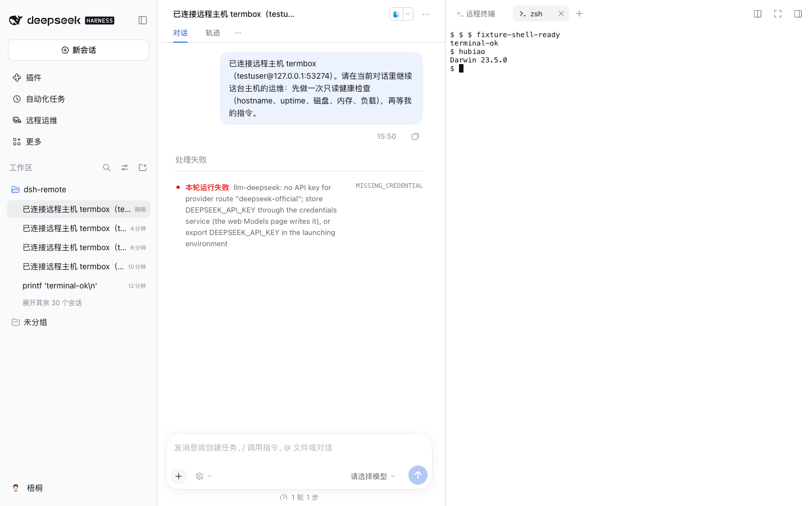
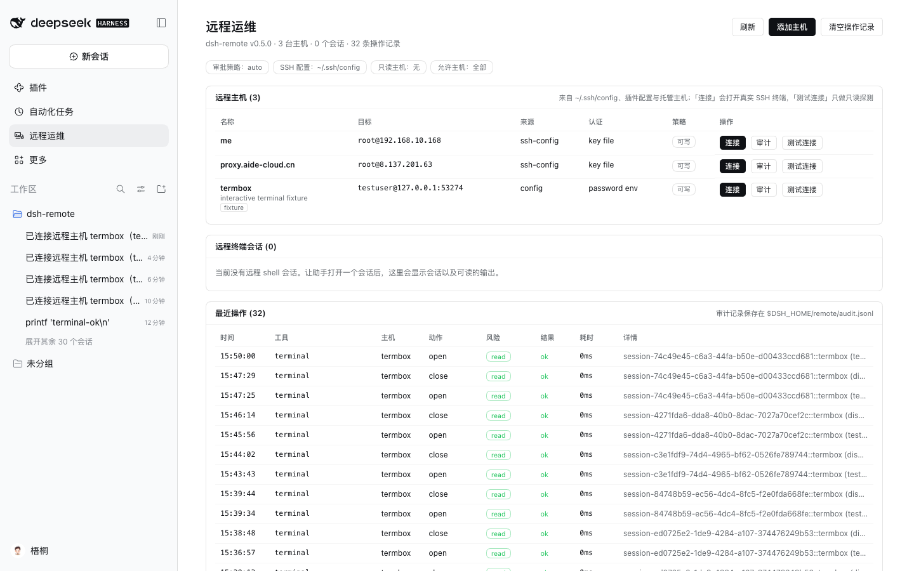

# dsh-remote

SSH remote-server operations for [DeepSeek Harness](https://www.deepseek.com/harness/) (DSH).

`dsh-remote` lets the agent in your DSH session actually operate remote servers:
list the hosts you already configured in `~/.ssh/config`, probe a box, run
non-interactive commands, read and edit remote files over SFTP, and move files
between the session workspace and a server — with a Crescent-style static
command-risk review in front of every mutating action and the DSH approval
dialog as the human gate.

It is inspired by the [Crescent](https://github.com/aide-family/Crescent)
operations workbench: the same idea that the agent should gather evidence on the
real host, one bounded action at a time, with risky commands reviewed before
execution.

## Features

- **Hosts you already have** — discovers every concrete `Host` in
  `~/.ssh/config` (including `Include`s) and merges a configurable host list;
  the model refers to hosts by name, exactly like `ssh <name>`.
- **Remote exec** — one-shot, non-interactive commands with working directory,
  timeout, bounded output, and a clear `[exit code: N]` result line.
- **Remote files over SFTP** — read (line-numbered, paginated), list, write
  (atomic temp + rename), exact-string edit, and upload/download transfers.
- **Persistent remote shells** — open an interactive PTY shell on a host and
  keep using it across tool calls (`remote_shell_*`): send input, read
  scrollback, interrupt with signals, close. Every submitted line is
  risk-reviewed like `remote_exec`.
- **Live terminal mirror** — a **Remote Terminal** tab in the conversation's
  right sidebar shows every remote command the agent runs as it runs, with
  streamed stdout/stderr and status lines. It opens automatically on the first
  command (or from the sidebar's Start page). See [Live terminal](#live-terminal-right-sidebar).

- **Interactive remote terminal** — the same right-sidebar **远程终端** panel
  picks an available host and opens DSH's native terminal attached to a
  persistent, per-conversation SSH session through a local relay: you type
  commands in a real xterm, close and re-open the tab to reattach the same
  session, and an SSH drop reconnects automatically with backoff. See
  [Interactive remote terminal](#interactive-remote-terminal-type-and-watch).
- **Quick connect from the host list** — one 连接 action creates the SSH
  session, opens the native terminal, and hands the host to the agent in the
  current conversation ("已连接远程主机 …") so it can continue operating.
- **Host manager** — add, edit and delete connection entries from the Remote Ops
  page (persisted in `$DSH_HOME/remote/hosts.json`; auth stays
  environment-variable names, never stored secrets).
- **Per-host audit** — an 审计 action on every host row lists that host's
  command and terminal-session history recorded by the plugin.
- **Non-mutating commands never ask** — under the default policy only commands
  the static classifier *proves* mutating need approval; read-only and
  unprovable-but-non-mutating commands (e.g. `curl`, `awk`, `python -c`) run
  directly, while `policy: never`, read-only hosts, `denyCommandPatterns` and the
  approval seam keep their stricter behaviour.
- **Remote Ops management page** — a first-level panel in the DSH Web GUI with
  the discovered host inventory (per-row read-only connection test), live remote
  shell sessions (scrollback preview + close), and a persisted audit trail of
  recent remote operations. See [Management page](#management-page-remote-ops).
- **Command risk review** — a port of Crescent's static classifier separates
  statically read-only commands (`low`) from clearly mutating ones (`high`) and
  unknown ones (`gray`); it understands shell lists, wrappers (`sudo`, `env`,
  `nohup`, `time`, `xargs`), `sh -c`/`ssh`/`kubectl exec` inner commands,
  `find -delete`, `sed -i`, `yq -i`, `docker`/`kubectl`/`systemctl` subcommands,
  and quoting.
- **Approval policy** — `auto` (read-only runs, mutations ask), `always`, or
  `never` (fail-closed headless stance). Denials, cancelled prompts, and a
  missing answerer all fail closed.
- **Hard limits** — per-host read-only lock, host allowlist, command deny
  patterns, output caps, transfer caps, and TOFU host-key verification.

## Requirements

- DSH `>= 0.2.1-rc.5` (bundled in the Desktop app and the `dsh` CLI).
- Node.js `^22.19.0 || >=24.0.0` (already bundled with DSH).
- SSH access to the target hosts: key files, `ssh-agent`, or a password supplied
  through an environment variable. `~/.ssh/config` settings (`HostName`, `User`,
  `Port`, `IdentityFile`, `ProxyJump`) are honored.

## Install

### From a local tarball (recommended for this checkout)

```sh
cd /Users/hubiao/aide-family/dsh-remote
npm install                       # once: ssh2 + test devDependencies
npm run install:profile           # packs dist/dsh-remote-<version>.tgz and installs
                                  # it into the "desktop" profile
```

Or do the steps manually and choose another profile:

```sh
npm run pack:plugin
dsh plugin --profile desktop add file:$PWD/dist/dsh-remote-0.5.0.tgz --ignore-scripts
```

Then fully quit and reopen the DSH Desktop app (a newly installed bundle is
loaded on the next boot), or boot the CLI profile you installed into.

> **`--ignore-scripts` is required with pnpm 11.** pnpm refuses to install
> packages that declare unapproved install scripts, and `ssh2` declares an
> install script for its *optional* native cipher-speed addon (`cpu-features`).
> ssh2's pure-JavaScript implementation is fully functional without it, so
> skipping the scripts is safe and avoids needing a C toolchain. (Alternatively,
> add `allowBuilds: [ssh2, cpu-features]` to the profile's `pnpm-workspace.yaml`
> and install without the flag; that does require a working compiler setup.)
>
> **Do not install a development checkout with `link:`.** DSH routes
> `@deepseek-ai/*` imports only for packages that physically live inside the
> profile's `node_modules`; a symlink to a directory outside the profile cannot
> resolve them and the plugin fails to load. Use the tarball (`file:…tgz`) for
> local installs, or the npm package when published.

### From npm (when published)

```sh
dsh plugin --profile desktop add dsh-remote --ignore-scripts
```

### Where it lands

The plugin is a DSH **bundle**: installing it adds the `dsh-remote` package and a
`dsh-remote` row to the profile. To remove it:

```sh
dsh plugin --profile desktop remove dsh-remote
```

## Configure

All settings live on the plugin's row in the profile patch. The desktop profile
patch is `~/.dsh/profiles/desktop/cordis.patch.yml`; a `--patch` overlay works
too (useful for headless and CI):

```yaml
- id: dsh-remote
  config:
    # Hosts not present in ~/.ssh/config. Never put secrets here — only the NAME
    # of an environment variable that holds the secret.
    hosts:
      - name: prod-web-1
        host: 10.0.0.11
        port: 22
        username: ops
        identityFile: ~/.ssh/prod_ed25519
        tags: [prod, web]
        description: primary web node
      - name: legacy-db
        host: 10.0.0.31
        username: dba
        passwordEnv: LEGACY_DB_SSH_PASSWORD   # exported in the DSH environment
    policy: auto                 # auto | always | never
    readonlyHosts: ["prod-*"]    # every mutating action on these is denied
    allowHosts: []               # empty = all; otherwise only matching hosts usable
    denyCommandPatterns: ["\\b(shutdown|reboot|mkfs)\\b"]
    connectTimeoutMs: 20000
    execTimeoutMs: 120000
    maxOutputBytes: 200000
    maxReadBytes: 800000
    maxTransferBytes: 52428800
    knownHostsPolicy: tofu       # tofu | strict | insecure
    unprovenCommands: allow      # allow (only provably mutating asks) | ask
    liveTerminal: true           # right-sidebar live terminal + /dsh-remote/live
    autoOpenLiveTerminal: true
    userTerminal: true           # interactive SSH terminal (relay + local bridge)
    userTerminalTtlMs: 1800000   # keep an unattached SSH session this long (0 = forever)
    userTerminalReconnectAttempts: 5
    userTerminalScrollbackBytes: 400000
    hostRegistryPath: ""         # default: $DSH_HOME/remote/hosts.json
```

Hosts from `~/.ssh/config` need no configuration at all. If `~/.ssh/config`
contains `Host prod-*` patterns, those wildcard entries are skipped (a pattern
is not a concrete target); add a concrete host block or a `hosts:` entry.

### Authentication

The transport tries, in order, and uses the first that applies:

1. `passwordEnv` — password auth; the env var is read at connect time.
2. `identityFile` — public-key auth (from plugin config or `~/.ssh/config`), with
   an optional passphrase from `passphraseEnv`.
3. `ssh-agent` (`SSH_AUTH_SOCK`).
4. Default keys: `~/.ssh/id_ed25519`, `~/.ssh/id_ecdsa`, `~/.ssh/id_rsa`.

Secrets are never read from YAML, never logged, and never included in tool
results or approval prompts.

### Host keys

`knownHostsPolicy` controls verification against
`$DSH_HOME/remote/known-hosts.json`:

- `tofu` (default) — trust and remember a host's key on first use; reject a
  changed key.
- `strict` — only previously remembered hosts connect.
- `insecure` — accept any key (the result carries a warning; not for production).

## Tools

| Tool | Read-only | Purpose |
| --- | --- | --- |
| `remote_hosts` | yes | List usable hosts, auth hints, and policy flags. |
| `remote_probe` | yes | Connect and report hostname, OS/kernel, uptime, load, memory, disk, and latency. |
| `remote_exec` | per classifier | Run one non-interactive command with optional `workdir` and timeout; only provably mutating commands ask for approval. |
| `remote_read` | yes | Read a remote text file with line numbers, `offset`/`limit`, and a continue hint. |
| `remote_list` | yes | List a remote directory with type/size/mtime/mode. |
| `remote_write` | no | Write a remote file atomically, creating missing directories. |
| `remote_edit` | no | Replace one exact string in a remote file (or all with `replace_all`). |
| `remote_transfer` | no | Upload/download between the session workspace and the host. |
| `remote_shell_open` | no | Open a persistent interactive PTY shell on a host. |
| `remote_shell_send` | per line | Write input (Enter submitted by default) and wait for output silence/timeout/exit. |
| `remote_shell_read` | yes | Read a bounded scrollback page (newest-relative). |
| `remote_shell_signal` | yes | Deliver SIGINT/SIGTERM/SIGKILL/SIGTSTP/SIGHUP to the foreground process group. |
| `remote_shell_close` | no | Close a session and wait for its process tree to end. |
| `remote_shell_list` | yes | List this agent's live shell sessions. |

Typical agent loop:

1. `remote_hosts` → choose the host name.
2. `remote_probe` → confirm reachability and rough state.
3. `remote_exec` read-only checks (`systemctl status`, `df -h`, `kubectl get pods`) → they run without asking.
4. Mutating step (`systemctl restart nginx`, `rm …`, `remote_write`, `remote_edit`) → command review + approval prompt, then execution.
5. `remote_read` the log/config to verify.

## Persistent remote shells

`remote_exec` is deliberately one-shot. For work that needs shell state across
calls — a REPL, an interactive prompt, a long-lived `cd`, environment variables,
or a running command you want to interrupt — open a PTY session instead:

```
remote_shell_open  { host: "me" }                       -> sessionId + shell motd
remote_shell_send  { sessionId, text: "cd /var/log" }   -> output delta
remote_shell_send  { sessionId, text: "tail -n 20 syslog" }
remote_shell_read  { sessionId, offset: 0, count: 200 } -> scrollback page
remote_shell_signal{ sessionId, signal: "SIGINT" }      -> interrupt a command
remote_shell_close { sessionId }
```

How a send settles: output silence (`inferred_idle`), the send timeout
(`timeout`), or the shell exiting (`session_exit`). `inferred_idle` and `timeout`
never prove the foreground command exited — read again or check with
`remote_shell_read`. Only one send may be active per session, and sessions are
owned by the agent that opened them.

Safety: every submitted line is classified exactly like `remote_exec` — read-only
lines run, mutating/unknown lines need approval, `policy: never` and read-only
hosts deny mutating input. `submit: false` raw control input is not classified
(it does not execute a line by itself); signals are mutating actions.

Limits: output is ANSI-sanitized line text, so full-screen TUIs (`vim`, `top`,
`less`) are not usable — run non-interactive commands instead, and put
long-running work in `nohup … > log 2>&1 &` then check it with `remote_read`.
Sessions are process-local and end when the harness restarts.

Configure with:

```yaml
- id: dsh-remote
  config:
    terminalEnabled: true          # register remote_shell_* (default true)
    terminalRows: 40
    terminalCols: 120
    terminalIdleSilenceMs: 800     # silence that settles a send
    terminalTimeoutMs: 30000       # absolute bound on one send
    terminalStartupTimeoutMs: 15000
    terminalScrollbackLines: 2000
    terminalScrollbackBytes: 2000000
    terminalMaxReadBytes: 262144
```

### Interactive remote terminal (type and watch)

The agent-side shell above shows each send's output in its tool card. The
interactive terminal is different: the **远程终端** panel picks a host and opens
DSH's native terminal (real xterm) connected by SSH, and **you** type in it.

How it works:

1. The **远程终端** panel lists the discovered hosts. Pick one and click
   **打开终端** (or **连接并对话** to also hand the host to the agent).
2. The plugin opens a native terminal tab in the right sidebar. A small local
   bridge (`bin/dsh-remote-terminal` → `lib/terminal/bridge.cjs`) connects to the
   Host's terminal relay over a user-only local socket; the relay owns the SSH
   PTY (`transport.openPty`). Everything you type reaches the remote shell, and
   its output (ANSI included) renders in xterm.
3. **One SSH session per conversation + host.** Re-opening the terminal for the
   same host reattaches the same relay session instead of dialing again; closing
   the terminal tab leaves the session alive for `userTerminalTtlMs` so a re-open
   continues where you were. The pooled SSH connection is shared with the
   agent's tools for the same host.
4. **Auto-recovery.** If the SSH channel drops, the relay reconnects with
   backoff (1s/2s/4s/8s/16s/30s, up to `userTerminalReconnectAttempts`) and
   prints a banner in the terminal; the bridge itself also retries when the DSH
   Host restarts. Nothing to re-type.

Limits: the relay keeps a bounded replay buffer (`userTerminalScrollbackBytes`,
default 400 KB) so a reattached terminal shows recent output; a full-screen TUI
is supported (it is a real PTY), but the agent still cannot use one through
`remote_shell_*`. The bridge needs `node` on the terminal's `PATH` (override with
`DSH_REMOTE_NODE`). Terminal sessions are process-local: a harness restart ends
them, and the terminal reconnects into a fresh shell on demand.

The old host-picker shell (`scripts/dsh-remote-shell`, an `ssh -t` session
configured through `terminal-controller`'s `shell` profile) still exists as a
standalone fallback, but it is not used by the panel.

## Live terminal (right sidebar)

Every `remote_exec` command and submitted `remote_shell_send` line is mirrored
into a right-sidebar tab, so you watch the real execution instead of only the
final tool card:



- **Opens automatically** on the first remote command of the session (the
  right-sidebar column expands), and is also available from the right sidebar's
  Start page as a **远程终端** entry.
- **Streams in real time**: a prompt line (`$ command`, host, session), the
  command's stdout/stderr chunks as they arrive, and a status line
  (`[exit 0 · 812ms]` / `[error: …]` / `[running]`). Denied commands appear too,
  so you see exactly what the agent attempted.
- **Bounded and private**: the stream is served from the running Host over a
  fenced same-origin SSE route (`/dsh-remote/live`); the Host keeps a bounded
  replay buffer (last 200 commands, 64 KiB per command, 1 MiB total) so a late
  panel still shows recent activity. Nothing is written to disk for the stream.
- **Controls**: connection state, per-host filter, local clear, auto-scroll
  (unless you scrolled up), automatic reconnect.

```yaml
- id: dsh-remote
  config:
    liveTerminal: true            # serve /dsh-remote/live + register the tab
    autoOpenLiveTerminal: true    # auto-open on the first command
```

**Approval policy (default `auto`)**: only provably mutating commands ask. Set
`unprovenCommands: "ask"` to require approval for commands the classifier cannot
prove read-only (unknown binaries, `curl`, `awk`, …), or keep the strict
`policy: never` for unattended runs (mutating and unproven commands are denied,
read-only commands run).

## Management page (Remote Ops / 远程运维)

The plugin registers a first-level sidebar panel in the DSH Web/Desktop GUI:



| Section | What you get |
| --- | --- |
| Remote hosts | Every discovered host (source, `user@host:port`, auth hint, readonly / allowHosts policy) with a per-row **测试连接 / Test connection** that runs one read-only probe (connect + `uname -srm; hostname`) and shows latency and output inline. |
| Host actions | Each row has an 操作 column: **连接** (quick connect: create the SSH session, open the native terminal, hand the host to the agent in the current conversation), **审计** (that host's command/terminal-session history), **编辑** / **删除** for managed hosts. **添加主机** opens the connection form. |
| Remote shell sessions | Live `remote_shell_*` sessions for every agent (session id, host, status) with a bounded scrollback preview and a **结束会话 / Close** action. |
| Recent operations | The audit trail of model-facing remote calls: time, tool, host, action, risk level (low/gray/high/write), outcome (ok / denied / error), duration, and the command/path. |

### Host manager

**添加主机** opens a form for a connection entry that does not live in
`~/.ssh/config`: name, host, port, user, key file, environment-variable names for
the password/passphrase, proxy jump, tags and description. Entries are persisted
in `$DSH_HOME/remote/hosts.json` (mode 0600, atomic writes) and merged into the
same host list as `~/.ssh/config` and the plugin `hosts:` config, winning on a
name collision. Raw secrets are never accepted: auth values are environment
variable **names**. Hosts discovered from `~/.ssh/config` or the plugin config
are listed read-only here (edit/delete only for managed entries).

### Per-host audit

**审计** on a host row opens that host's operation history from the same audit
trail: every model-facing remote call (tool, action, risk, outcome, duration,
command/path) plus interactive-terminal lifecycle events (open / reconnect /
close). User keystrokes typed in the interactive terminal are never recorded
(they can contain passwords typed at a sudo prompt).

The page polls the Host every 10 seconds and has manual refresh and audit-clear
buttons. It is backed by a small same-origin JSON API at `/dsh-remote/api`
(`overview`, `host.test`, `host.create`, `host.update`, `host.delete`,
`audit.list`, `terminal.open`, `terminal.list`, `terminal.close`, `session.read`,
`session.close`, `audit.clear`) that is mounted only when a web server exists and
is fenced by the same Host/Origin + browser-cookie check DSH's own `/api` uses.
The audit trail is also appended to `$DSH_HOME/remote/audit.jsonl` (bounded tail
reloaded on startup), so it survives a restart.

Disable the HTTP API/page backend with `managementApi: false` in the plugin
config if you do not want the route registered.

## Safety model

- **Static review before approval.** Every `remote_exec` command is classified
  by the ported Crescent classifier. Under `policy: auto` only `high` (provably
  mutating) commands need approval; `low` and `gray` (unproven) run directly,
  with the live terminal and audit trail recording them. `unprovenCommands: ask`
  restores approval for the unproven class, and `remote_write` / `remote_edit` /
  `remote_transfer` always need approval.
- **Fail closed.** No approval answerer mounted, a cancelled prompt, a rejected
  prompt, or an approval-service failure all deny the action.
- **`policy: never`** is the headless/unattended stance: statically read-only
  actions work; mutating and unproven actions are denied with an explanation.
- **Host-level guards.** `readonlyHosts` denies every mutating action on matching
  hosts in every policy mode; `allowHosts` (non-empty) hides and rejects
  everything else; `denyCommandPatterns` always denies a matching command.
- **Bounded everything.** Exec output is capped (tail kept, marker added), reads
  are paginated, transfers are capped, and connections/commands time out.
- **Workspace-scoped transfers.** Local transfer paths resolve against the
  session working directory and must stay inside it unless
  `allowLocalOutsideWorkspace: true`.

## Development

```sh
npm install                       # ssh2 + test devDependencies
npm test                          # unit + integration tests (no real servers)
npm run e2e                       # real DSH headless run against a fixture SSH server
npm run dev:profile               # create the isolated DSH dev profile
npm run dev:sync                  # copy lib/ into the dev profile's node_modules
```

The integration and e2e suites run a **real SSH server fixture**
(`test/fixtures/ssh-server.mjs`, built on ssh2's server) on `127.0.0.1`, so no
external host, key, or network access is required.

The e2e suite uses an isolated `DSH_HOME` (`./.dsh-test`), a `remotedev` profile
created from the shipped headless template, and the credentials already saved by
the desktop app (symlinked, never copied). It asserts the real harness loads the
plugin, registers the tools, and executes read-only remote actions; mutating
actions are asserted to fail closed in headless mode.

## Known limitations

- **No persistent remote shell.** `remote_exec` is one-shot (no PTY): each call
  is a fresh shell. Long-running processes must be started detached
  (`nohup … &`); interactive programs (vim, top) are not supported.
- **`remote_read` pages within `maxReadBytes`.** Line `offset`/`limit` work on
  the file window returned by one read; a file larger than `maxReadBytes`
  cannot be paged past that window. Use `remote_exec` with `tail -n`/`grep`/
  `sed -n` or `remote_transfer` for very large files.
- **Workspace containment is lexical.** Transfer local paths are checked
  lexically against the session working directory (no symlink resolution);
  keep `allowLocalOutsideWorkspace: false` unless you need otherwise.
- **GUI host management is limited to env-var auth.** The form stores connection
  metadata only (`~/.ssh/config`/plugin-config hosts stay authoritative for their
  own entries); passwords and key passphrases are environment-variable names, so
  a managed host still needs that variable exported to the DSH process.
- **One connection per host.** Operations for one host are serialized through a
  single pooled SSH connection (plus ProxyJump hops), so concurrent calls to the
  same host queue rather than open many sessions.
- **No full-screen TUI in agent shells.** `remote_shell_*` output is
  line-sanitized, so `vim`/`top`/`less` are not usable from the agent; use
  non-interactive commands. The interactive terminal (above) is a real xterm and
  supports them for the user.
- **Shell sessions and the live stream are process-local.** The terminal mirror
  retains a bounded in-memory buffer only; a harness restart clears it (the audit
  trail persists). Interactive-terminal sessions behave the same way: the relay
  keeps them across terminal close/reload and reconnects an SSH drop, but a
  harness restart starts a fresh shell on the next open.
- **The interactive terminal is user-driven.** It runs with the Host user's SSH
  credentials and is not gated by the agent approval policy; `allowHosts` still
  restricts which hosts may be opened. The local bridge needs `node` on the
  terminal `PATH` (or `DSH_REMOTE_NODE`).
- **The live mirror shows `remote_exec` and shell sends**, not file reads/writes
  (those keep their tool cards) and not commands run outside the plugin.
- **One send at a time per remote shell**, bounded by `terminalTimeoutMs`.
- **The management page needs the Web/Desktop surface.** Headless CLI runs have
  no HTTP server, so the API and page are not mounted there (tools still work).
- **Session list is process-local.** The page shows sessions of the running
  harness process; the audit trail is persisted, sessions are not.
- **No port forwarding / tunnels.** The plugin runs commands and file transfers;
  `ssh -L`-style forwarding is out of scope.

## Layout

```
lib/
  index.js        plugin entry (apply, Config, prompt section, wiring)
  client.js       browser half: sidebar "Remote Ops" panel + page
  api.js          Host JSON API behind the management page (fenced)
  audit.js        bounded audit trail (memory ring + JSONL persistence)
  live.js         live command hub for the right-sidebar terminal
  live-stream.js  fenced SSE transport (/dsh-remote/live)
  tools.js        8 defineTool definitions
  render.js       canonical value -> model text
  approval.js     policy + risk review + DSH approval seam
  host-store.js   cached host discovery/resolution
  config.js       Schemastery Config + normalizeConfig
  hosts.js        ~/.ssh/config + config + managed host merge/resolve
  host-registry.js persisted managed-host CRUD ($DSH_HOME/remote/hosts.json)
  ssh-config.js   ~/.ssh/config parser (Include, ProxyJump, …)
  policy/         ported Crescent static command-risk classifier
  ssh/            ssh2 pool, auth, exec, SFTP, known hosts
  terminal/       agent PTY shells (v0.2) + interactive user terminal relay/bridge (v0.5)
bin/
  dsh-remote-terminal  POSIX launcher run inside the native terminal (v0.5)
test/
  unit/           pure-module tests
  integration/    fake-ctx plugin tests + fixture SSH server
  fixtures/       ssh-server.mjs
scripts/          dev-profile, sync-profile, e2e, dev-web (browser loop), packaging
```

Attribution: the command-risk classifier in `lib/policy/` is ported from the
Crescent project (`aide-family/Crescent`, `src/shared/command-guard.ts`,
`src/shared/shell-command.ts`, `src/shared/command-policy/`).

## Verification

```sh
npm test        # 642 tests: unit + real-fixture integration (no external servers)
npm run e2e     # real DSH headless run against a fixture SSH server
node scripts/dev-web-test.mjs --remote-terminal --docs-shots   # real browser loop (v0.5)
```

The e2e suite proves the model actually calls the tools through the DSH pipeline,
that read-only remote actions work, that mutating actions fail closed in headless
mode, that a persistent PTY shell opens, echoes a command, and closes cleanly,
and that an unproven (gray) command now runs without approval. The management page is verified in a real browser against an isolated
DSH Web profile (`npm run dev:web` boots it, drives it with headless Chrome, and
writes a screenshot); the checked-in screenshots above were produced that way.
`--emit-live` verifies the v0.4 live mirror (guide entry, auto-open, streamed
commands/output, session and host filters, scrolling, Clear). `--remote-terminal`
boots the same profile with a real SSH fixture host and verifies v0.5 end to end:
the actions column, quick connect creating the relay PTY and opening DSH's native
terminal, typing a command into the xterm, the `已连接远程主机 …` conversation
handoff, the per-host audit modal, the host-manager add/delete round-trip, and
per-conversation session reuse (same sessionKey on a second open) — with zero
browser console errors. `--docs-shots` additionally captures
`docs/assets/remote-terminal.png` from a clean panel-driven terminal (no agent
handoff). Run the browser loop with full process access: the DSH Host must be able
to allocate a POSIX PTY for the native terminal, which an agent workspace sandbox
can deny (`posix_openpt: Operation not permitted`). A packaged tarball
install is verified separately:

```sh
npm run pack:plugin
dsh plugin --profile <test-profile> add file:$PWD/dist/dsh-remote-<version>.tgz --ignore-scripts
E2E_SKIP_SYNC=1 DSH_TEST_PROFILE=<test-profile> node scripts/e2e.mjs
```

## Troubleshooting

| Symptom | Cause / fix |
| --- | --- |
| `Cannot find package '@deepseek-ai/dsh-tools'` | The plugin was installed with a symlink (`link:`) outside the profile. Reinstall from a tarball/npm so it lives under `<profile>/node_modules`. |
| `denied because no approval answerer is mounted` | Headless or unattended run; use `policy: never` for read-only automation, or run the interactive Web/Desktop surface for mutating work. |
| `HOST_KEY` / changed host key | A previous key is remembered in `$DSH_HOME/remote/known-hosts.json`; verify the server key and remove the stale entry (or switch `knownHostsPolicy`). |
| `AUTH` failure | Check `ssh -v <host>` works with the same user/key; verify `identityFile`, `SSH_AUTH_SOCK`, or the `passwordEnv` variable is visible to the DSH process (the app may not inherit your shell's exports). |
| Host missing from `remote_hosts` | Wildcard-only `Host` blocks and hostname-less entries are skipped; add a concrete host block or a `hosts:` config entry. |

## License

MIT. See [LICENSE](./LICENSE).
