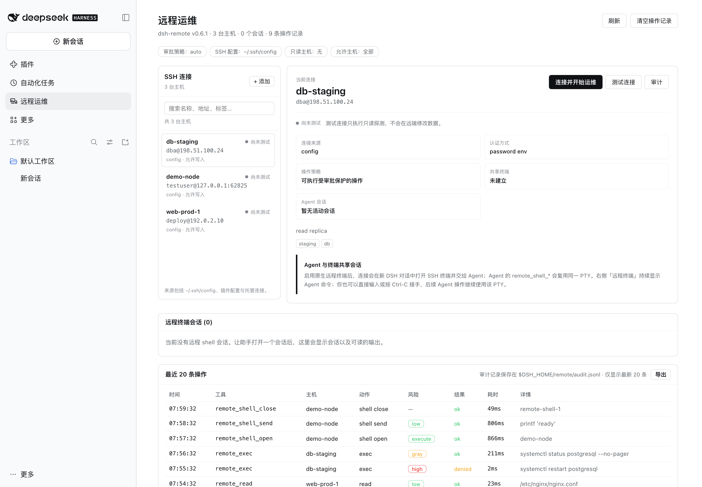
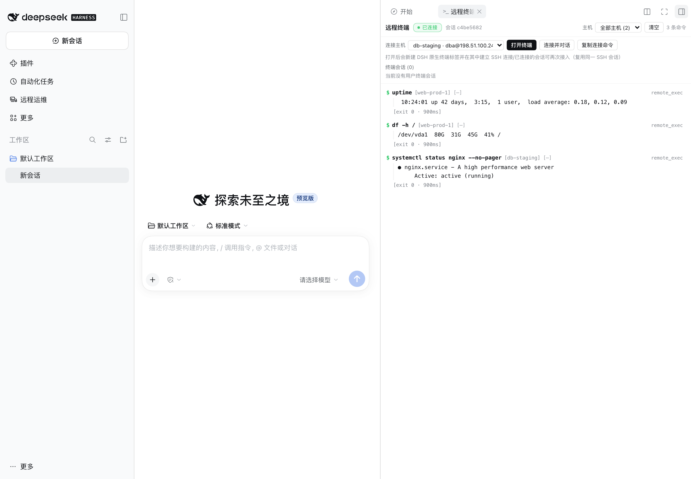
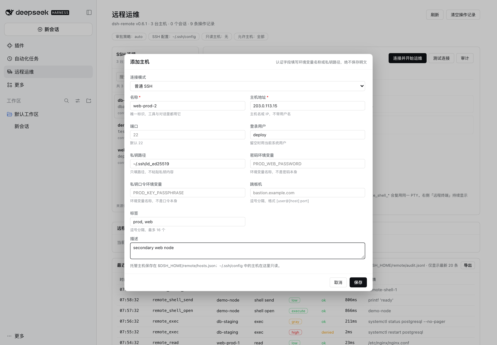
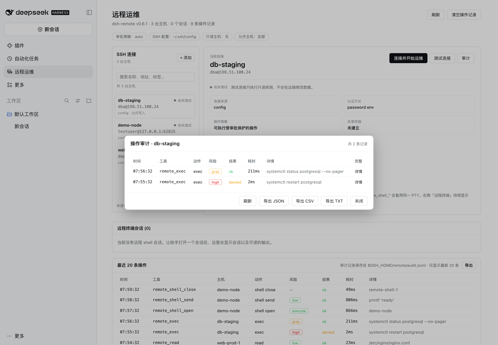

# dsh-remote

SSH remote-server operations for [DeepSeek Harness](https://www.deepseek.com/harness/) (DSH).

## Quick start

### 1. Install DSH

`dsh-remote` is a DSH plugin, so install and launch DSH first.

**Desktop app (recommended).** Download the official app for
[macOS or Windows](https://www.deepseek.com/en/download/), open it, and finish the
first-run sign-in. The desktop app bundles its own `dsh` CLI and Node.js.

**CLI / Web UI.** Requires Node.js `>= 24.9.0`:

```sh
# run without a global install
npx -y @deepseek-ai/dsh web

# or install the CLI once and reuse it
npm install -g @deepseek-ai/dsh
dsh web
```

`dsh web` prints an authenticated local URL (for example
`http://127.0.0.1:3080/`). Open it in a browser. Then check the version:

```sh
dsh --version   # must be >= 0.2.1-rc.5
```

> With the Desktop app, `dsh` may not be on your shell `PATH`; either use the
> app or install the CLI as above. The plugin also needs SSH access to the
> target hosts: key files, `ssh-agent`, or a password supplied through an
> environment variable. `~/.ssh/config` settings (`HostName`, `User`, `Port`,
> `IdentityFile`, `ProxyJump`) are honored.

### 2. Install dsh-remote

From npm:

```sh
dsh plugin --profile desktop add @aide-family/dsh-remote --ignore-scripts
```

From a local checkout:

```sh
cd /path/to/dsh-remote
npm install                       # once: ssh2 + test devDependencies
npm run install:profile           # packs dist/aide-family-dsh-remote-<version>.tgz and installs
                                  # it into the "desktop" profile
```

Or pack and install manually into another profile:

```sh
npm run pack:plugin
dsh plugin --profile desktop add file:$PWD/dist/aide-family-dsh-remote-0.6.1.tgz --ignore-scripts
```

Install into the profile you actually boot: `desktop` for the Desktop app, or
`web` when you launched `dsh web` (the CLI also accepts `--profile web`).

Then fully quit and reopen the DSH Desktop app (a newly installed bundle is
loaded on the next boot), or boot the CLI profile you installed into. Open the
**远程运维** panel in the sidebar, or ask the agent to call `remote_hosts`, to
confirm the plugin loaded.

> **`--ignore-scripts` is required with pnpm 11.** pnpm refuses to install
> packages that declare unapproved install scripts, and `ssh2` declares an
> install script for its *optional* native cipher-speed addon (`cpu-features`).
> ssh2's pure-JavaScript implementation is fully functional without it, so
> skipping the scripts is safe and avoids needing a C toolchain. (Alternatively,
> add `allowBuilds: [ssh2, cpu-features]` to the profile's `pnpm-workspace.yaml`
> and install without the flag; that does require a working compiler setup.)
>
> **Do not install a development checkout with `link:`.** DSH routes
> `@deepseek-ai/*` imports only for packages that physically live inside the
> profile's `node_modules`; a symlink to a directory outside the profile cannot
> resolve them and the plugin fails to load. Use the tarball (`file:…tgz`) for
> local installs, or the npm package when published.

The plugin is a DSH **bundle**: installing it adds the
`@aide-family/dsh-remote` package and a `dsh-remote` plugin row to the profile.
To remove it:

```sh
dsh plugin --profile desktop remove @aide-family/dsh-remote
```

## What dsh-remote does

`dsh-remote` lets the agent in your DSH session actually operate remote servers:
list the hosts you already configured in `~/.ssh/config`, probe a box, run
non-interactive commands, read and edit remote files over SFTP, and move files
between the session workspace and a server — with a Crescent-style static
command-risk review in front of every mutating action and the DSH approval
dialog as the human gate.

It is inspired by the [Crescent](https://github.com/aide-family/Crescent)
operations workbench: the same idea that the agent should gather evidence on the
real host, one bounded action at a time, with risky commands reviewed before
execution.

## Screenshots

The screenshots below come from an isolated documentation profile: synthetic
hosts on RFC 5737 documentation addresses, a loopback SSH fixture, and synthetic
command output. No real host, account, key, or local path is shown.

**Remote Ops management page.** Host inventory, per-host detail, live shell
sessions, and the recent-operation audit trail in one panel.



**Live terminal mirror.** Every agent command streams into the conversation's
right sidebar; the same panel opens DSH's native terminal on a chosen host.



**Host manager.** Add, edit, or remove managed connections. Secrets stay as
environment-variable names or key paths.



**Per-host audit.** Filter by host, expand the full command, or export
JSON/CSV/TXT.



**Native remote terminal.** A real xterm attached to the per-conversation SSH
session; close and re-open the tab to reattach it.


## Features

- **Hosts you already have** — discovers every concrete `Host` in
  `~/.ssh/config` (including `Include`s) and merges a configurable host list;
  the model refers to hosts by name, exactly like `ssh <name>`.
- **Remote exec** — one-shot, non-interactive commands with working directory,
  timeout, bounded output, and a clear `[exit code: N]` result line.
- **Remote files over SFTP** — read (line-numbered, paginated), list, write
  (atomic temp + rename), exact-string edit, and upload/download transfers.
- **Persistent remote shells** — open an interactive PTY shell on a host and
  keep using it across tool calls (`remote_shell_*`): send input, read
  scrollback, interrupt with signals, close. Every submitted line is
  risk-reviewed like `remote_exec`.
- **Live terminal mirror** — a **Remote Terminal** tab in the conversation's
  right sidebar shows every remote command the agent runs as it runs, with
  streamed stdout/stderr and status lines. It opens automatically on the first
  command (or from the sidebar's Start page). See [Live terminal](#live-terminal-right-sidebar).

- **Interactive remote terminal** — the same right-sidebar **远程终端** panel
  picks an available host and opens DSH's native terminal attached to a
  persistent, per-conversation SSH session through a local relay: you type
  commands in a real xterm, close and re-open the tab to reattach the same
  session, and an SSH drop reconnects automatically with backoff. See
  [Interactive remote terminal](#interactive-remote-terminal-type-and-watch).
- **Quick connect from the host list** — one 连接 action creates the SSH
  session, opens a **new conversation**, attaches DSH's native terminal to it,
  and hands the host to the agent there ("已连接远程主机 …") so operations start
  in a dedicated conversation. Failures after the switch are shown in the
  远程终端 panel (never a silent local shell), and 复制连接命令 copies the exact
  shell line for any terminal when the native-terminal integration is
  unavailable.
- **Host manager** — add, edit and delete connection entries from the Remote Ops
  page (persisted in `$DSH_HOME/remote/hosts.json`; auth stays
  environment-variable names, never stored secrets).
- **Per-host audit** — an 审计 action on every host row lists that host's
  command and terminal-session history recorded by the plugin.
- **Non-mutating commands never ask** — under the default policy only commands
  the static classifier *proves* mutating need approval; read-only and
  unprovable-but-non-mutating commands (e.g. `curl`, `awk`, `python -c`) run
  directly, while `policy: never`, read-only hosts, `denyCommandPatterns` and the
  approval seam keep their stricter behaviour.
- **Remote Ops management page** — a first-level panel in the DSH Web GUI with
  the discovered host inventory (per-row read-only connection test), live remote
  shell sessions (scrollback preview + close), and a persisted audit trail of
  recent remote operations. See [Management page](#management-page-remote-ops).
- **Command risk review** — a port of Crescent's static classifier separates
  statically read-only commands (`low`) from clearly mutating ones (`high`) and
  unknown ones (`gray`); it understands shell lists, wrappers (`sudo`, `env`,
  `nohup`, `time`, `xargs`), `sh -c`/`ssh`/`kubectl exec` inner commands,
  `find -delete`, `sed -i`, `yq -i`, `docker`/`kubectl`/`systemctl` subcommands,
  and quoting.
- **Approval policy** — `auto` (read-only runs, mutations ask), `always`, or
  `never` (fail-closed headless stance). Denials, cancelled prompts, and a
  missing answerer all fail closed.
- **Hard limits** — per-host read-only lock, host allowlist, command deny
  patterns, output caps, transfer caps, and TOFU host-key verification.

## Configure

All settings live on the plugin's row in the profile patch. The desktop profile
patch is `~/.dsh/profiles/desktop/cordis.patch.yml`; a `--patch` overlay works
too (useful for headless and CI):

```yaml
- id: dsh-remote
  config:
    # Hosts not present in ~/.ssh/config. Never put secrets here — only the NAME
    # of an environment variable that holds the secret.
    hosts:
      - name: prod-web-1
        host: 10.0.0.11
        port: 22
        username: ops
        identityFile: ~/.ssh/prod_ed25519
        tags: [prod, web]
        description: primary web node
      - name: legacy-db
        host: 10.0.0.31
        username: dba
        passwordEnv: LEGACY_DB_SSH_PASSWORD   # exported in the DSH environment
    policy: auto                 # auto | always | never
    readonlyHosts: ["prod-*"]    # every mutating action on these is denied
    allowHosts: []               # empty = all; otherwise only matching hosts usable
    denyCommandPatterns: ["\\b(shutdown|reboot|mkfs)\\b"]
    connectTimeoutMs: 20000
    execTimeoutMs: 120000
    maxOutputBytes: 200000
    maxReadBytes: 800000
    maxTransferBytes: 52428800
    knownHostsPolicy: tofu       # tofu | strict | insecure
    unprovenCommands: allow      # allow (only provably mutating asks) | ask
    liveTerminal: true           # right-sidebar live terminal + /dsh-remote/live
    autoOpenLiveTerminal: true
    userTerminal: true           # interactive SSH terminal (relay + local bridge)
    userTerminalTtlMs: 1800000   # keep an unattached SSH session this long (0 = forever)
    userTerminalReconnectAttempts: 5
    userTerminalScrollbackBytes: 400000
    hostRegistryPath: ""         # default: $DSH_HOME/remote/hosts.json
```

Hosts from `~/.ssh/config` need no configuration at all. If `~/.ssh/config`
contains `Host prod-*` patterns, those wildcard entries are skipped (a pattern
is not a concrete target); add a concrete host block or a `hosts:` entry.

### Cluster shortcuts with ordered terminal actions

The host manager can save a **cluster shortcut** through an existing SSH entry
(for example `bastion-demo`). Replace the former fixed login command with an ordered
**action list**: add/remove/reorder actions, select each type, and configure its
completion condition and timeout. The same `actions` field works in plugin `hosts`
configuration:

```json
{
  "name": "cluster-a",
  "viaHost": "bastion-demo",
  "actions": [
    { "type": "command", "value": "sww -r -u demo.user cluster-a", "expectCluster": "cluster-a" },
    { "type": "command", "value": "cd /tmp" }
  ],
  "tags": ["cluster", "cluster-a"],
  "description": "cluster-a cluster through bastion-demo"
}
```

After entrance SSH authentication, actions run sequentially in the **same shared
PTY** used by the human and Agent. A new ordinary-shell sequence waits for the
entry prompt before sending. For a menu or custom entrance prompt, put a literal
`wait` action first: that output becomes the readiness barrier instead of a generic
Shell prompt. Connection readiness means all configured action completion
conditions were met, not merely that a terminal tab opened.

| Type | Input | Completion |
| --- | --- | --- |
| `command` | Printable single-line `value`, automatically followed by Enter | Shell prompt by default; optional literal `expect`, or `expectCluster` for a root prompt on that cluster |
| `text` | Printable `value`, no Enter appended | Input issuance, or optional literal `expect` |
| `key` | `Enter`, `Tab`, `Escape`, `Ctrl-C`, `Ctrl-D`, arrow keys, or `Backspace` | Input issuance, or optional literal `expect` |
| `wait` | Literal output `value`, not a regular expression | That unconsumed output is observed |
| `delay` | `durationMs` | Cancellable timer completes |

Example menu interaction: `wait` for `Select cluster:` → `text` with `1` → `key`
`Enter` → `wait` for the target's success message. Text/key issuance alone does
not prove an interaction completed. A Shell prompt does **not** prove exit code 0
or the intended target was reached; for a login/target change, configure explicit
target-success output or the target-cluster root check.

Since 0.6.1, default completion accepts mode-prefixed user@host prompts such as
`[ K8S-RONLY ]root@web1.region-a.example.test:~#`, including streamed ANSI output.
The explicit `expectCluster` check still matches the actual root hostname's domain
segment, not a Kubernetes context name: a logical `cluster-b` context may use a
`.region-a` pod hostname. In that case use observed literal `expect` output rather than
requiring a nonexistent `.cluster-b` hostname. Mode labels alone do not mark ready;
matching a prompt does not grant write permission or override read-only policy.

There may be 1–32 actions, each optionally labelled. Send text is bounded to 4096
characters with no control characters; waits are bounded to 2048 characters.
`timeoutMs` defaults to 30000, range 100–120000. Delays are 0–120000 ms and the
whole sequence is capped at 20 minutes. Progress exposes counts/type/label only,
not raw action input or output. **Do not embed passwords, tokens or private keys
in actions**; entrance authentication uses the secure user-only dialog or existing
credential references.

A timeout, cancellation, PTY exit or execution error stops the sequence without
sending remaining actions. Observing a completion condition is not a command
exit-code check. Reattaching/adopting an initialized PTY does not replay actions;
user-terminal reconnects initialize the genuinely new channel once. Agent-owned
PTYs keep the no-silent-reconnect rule. Legacy `viaHost` + `loginCommand` records
are automatically migrated into one command action while retaining the original
root-on-target confirmation; saving the editor uses `actions` only.

Shortcuts inherit entrance SSH settings, `allowHosts` and read-only restrictions;
missing entrances, self-reference, cycles and multi-level shortcuts still fail.
They remain **terminal-only**: select the shortcut in Remote Ops or use
`remote_shell_open`, then reuse its session id with `remote_shell_send/read/signal`.
Exec, probe and SFTP would target the entrance and remain disabled. Every automatic
send respects command risk and deny patterns; no saved action grants approval.
Strict policies (`always`, `never`, `unprovenCommands: ask`), read-only unproven
inputs or a high-risk send requiring unavailable approval fail explicitly. Use the
ordinary entrance terminal and the normal approved manual flow in those cases.

### Authentication

The transport tries, in order, and uses the first that applies:

1. `passwordEnv` — password auth; the env var is read at connect time.
2. `identityFile` — public-key auth (from plugin config or `~/.ssh/config`), with
   an optional passphrase from `passphraseEnv`.
3. `ssh-agent` (`SSH_AUTH_SOCK`).
4. Default keys: `~/.ssh/id_ed25519`, `~/.ssh/id_ecdsa`, `~/.ssh/id_rsa`.

For an interactive terminal connection that fails with `AUTH`, the UI now opens
a masked **SSH 密码登录** dialog. A successful fixed password is retained only in
Host process memory for that exact host/port/user until plugin disposal or app
restart; it is never saved to the host registry, sent to the Agent, or recorded
in audit/debug logs. Failed passwords are not cached or automatically retried.
The browser uses the existing authenticated Host/Origin-fenced API.

Password auth also supports a single non-echoing `Password:` keyboard-interactive
challenge. OTP/MFA prompts, multiple prompts, echoing prompts, repeated rounds,
and interactive password login through ProxyJump are not supported; a fixed
password is never automatically supplied to those challenges. The parser honors
`PubkeyAuthentication`, `PasswordAuthentication`, and
`KbdInteractiveAuthentication` for concrete SSH Host blocks. In particular,
`PubkeyAuthentication no` prevents fallback to default private keys.

Secrets are never read from YAML, never logged, and never included in tool
results or approval prompts.

### Host keys

`knownHostsPolicy` controls verification against
`$DSH_HOME/remote/known-hosts.json`:

- `tofu` (default) — trust and remember a host's key on first use; reject a
  changed key.
- `strict` — only previously remembered hosts connect.
- `insecure` — accept any key (the result carries a warning; not for production).

## Tools

| Tool | Read-only | Purpose |
| --- | --- | --- |
| `remote_hosts` | yes | List usable hosts, auth hints, and policy flags. |
| `remote_probe` | yes | Connect and report hostname, OS/kernel, uptime, load, memory, disk, and latency. |
| `remote_exec` | per classifier | Run one non-interactive command with optional `workdir` and timeout; only provably mutating commands ask for approval. |
| `remote_read` | yes | Read a remote text file with line numbers, `offset`/`limit`, and a continue hint. |
| `remote_list` | yes | List a remote directory with type/size/mtime/mode. |
| `remote_write` | no | Write a remote file atomically, creating missing directories. |
| `remote_edit` | no | Replace one exact string in a remote file (or all with `replace_all`). |
| `remote_transfer` | no | Upload/download between the session workspace and the host. |
| `remote_shell_open` | no | Open a persistent interactive PTY shell on a host. |
| `remote_shell_send` | per line | Write input (Enter submitted by default) and wait for output silence/timeout/exit. |
| `remote_shell_read` | yes | Read a bounded scrollback page (newest-relative). |
| `remote_shell_signal` | yes | Deliver SIGINT/SIGTERM/SIGKILL/SIGTSTP/SIGHUP to the foreground process group. |
| `remote_shell_close` | no | Close a session and wait for its process tree to end. |
| `remote_shell_list` | yes | List this agent's live shell sessions. |

Typical agent loop:

1. `remote_hosts` → choose the host name.
2. `remote_probe` → confirm reachability and rough state.
3. `remote_exec` read-only checks (`systemctl status`, `df -h`, `kubectl get pods`) → they run without asking.
4. Mutating step (`systemctl restart nginx`, `rm …`, `remote_write`, `remote_edit`) → command review + approval prompt, then execution.
5. `remote_read` the log/config to verify.

## Persistent remote shells

`remote_exec` is deliberately one-shot. For work that needs shell state across
calls — a REPL, an interactive prompt, a long-lived `cd`, environment variables,
or a running command you want to interrupt — open a PTY session instead:

```
remote_shell_open  { host: "me" }                       -> sessionId + shell motd
remote_shell_send  { sessionId, text: "cd /var/log" }   -> output delta
remote_shell_send  { sessionId, text: "tail -n 20 syslog" }
remote_shell_read  { sessionId, offset: 0, count: 200 } -> scrollback page
remote_shell_signal{ sessionId, signal: "SIGINT" }      -> interrupt a command
remote_shell_close { sessionId }
```

How a send settles: output silence (`inferred_idle`), the send timeout
(`timeout`), or the shell exiting (`session_exit`). `inferred_idle` and `timeout`
never prove the foreground command exited — read again or check with
`remote_shell_read`. Only one send may be active per session, and sessions are
owned by the agent that opened them.

Safety: every submitted line is classified exactly like `remote_exec` — read-only
lines run, mutating/unknown lines need approval, `policy: never` and read-only
hosts deny mutating input. `submit: false` raw control input is not classified
(it does not execute a line by itself); signals are mutating actions.

Limits: output is ANSI-sanitized line text, so full-screen TUIs (`vim`, `top`,
`less`) are not usable — run non-interactive commands instead, and put
long-running work in `nohup … > log 2>&1 &` then check it with `remote_read`.
Sessions are process-local and end when the harness restarts.

Configure with:

```yaml
- id: dsh-remote
  config:
    terminalEnabled: true          # register remote_shell_* (default true)
    terminalRows: 40
    terminalCols: 120
    terminalIdleSilenceMs: 800     # silence that settles a send
    terminalTimeoutMs: 30000       # absolute bound on one send
    terminalStartupTimeoutMs: 15000
    terminalScrollbackLines: 2000
    terminalScrollbackBytes: 2000000
    terminalMaxReadBytes: 262144
```

### Interactive remote terminal (type and watch)

The agent-side shell above shows each send's output in its tool card. The
interactive terminal is different: the **远程终端** panel picks a host and opens
DSH's native terminal (real xterm) connected by SSH, and **you** type in it.

How it works:

1. The **远程终端** panel (or a host row's **连接** on the Remote Ops page)
   lists the discovered hosts. Pick one and click **打开终端**/**连接并对话**.
   **连接** creates/reuses the SSH session and opens a **new conversation**,
   then attaches the native terminal there; **打开终端** in the panel uses the
   current conversation.
2. The plugin opens a native terminal tab in the right sidebar of that
   conversation. A small local bridge (`bin/dsh-remote-terminal` →
   `lib/terminal/bridge.cjs`) connects to the Host's terminal relay over a
   user-only local socket; the relay in the DSH Host process owns the SSH PTY
    (`transport.openPty`). This is an interactive SSH shell in DSH's native
    terminal, **not a local
    `ssh` process**. The browser plugin cannot spawn OS processes; it writes one
    quoted bridge-launch line via DSH's terminal-view API and verifies the relay
    attachment.
   Everything you type reaches the remote shell, and its output (ANSI included)
   renders in xterm. If the tab or the bridge cannot be established, the panel
   says so, shows the exact command with **复制命令**, and points at
   `$DSH_HOME/remote/terminal-bridge.log` — paste the command into any local
   terminal to connect manually.
3. **The Agent and human share the exact PTY.** The relay's canonical key is
   `(DSH conversation id, host)`. When `remote_shell_open` runs in that
   conversation, the Agent shell manager borrows that relay PTY rather than
   opening another SSH shell channel; opens are reused per Agent + host. Reopening
   the native terminal attaches to the same relay session. Closing its tab does
   not idle-close an Agent-owned PTY; `remote_shell_close`, Agent disposal, or
   plugin shutdown closes the shared session.
4. **Recovery is state-aware.** A terminal-only relay can reconnect with backoff
   (1s/2s/4s/8s/16s/30s, up to `userTerminalReconnectAttempts`) and the bridge
   retries when the DSH Host restarts. If an Agent owns the PTY and its SSH
   channel exits, the relay marks that shared shell ended instead of reconnecting
   to a fresh shell that would falsely appear to preserve state; explicitly open
   a new session to continue.

**The terminal must actually be connected.** Opening a tab is not proof: after
writing the local bridge launch line once, the panel waits for a *new* bridge
attach beyond the session's pre-launch counter and requires the relay SSH state
to be `connected`. It never replays the launch line automatically: if the first
write was delayed, replaying it could reach an already-connected remote shell as
user input. On failure it does not claim success; it shows the exact command
with a **复制命令** button plus the path of
`$DSH_HOME/remote/terminal-bridge.log`. The shell line
does not depend on the terminal's `PATH`: it uses the Host's own node binary
(directly, through `ELECTRON_RUN_AS_NODE` in the Desktop app, or the bundled
runtime node) and falls back to the packaged launcher. The panel also shows the
live session state — `接入 N` (attached terminals), the short session key, and a
`复用` badge when the same SSH session was reattached — so connection reuse is
visible instead of assumed. The relay records `terminal attach/detach` audit
events, so a session that opened but never attached is visible in the host's
audit history.

Limits: the relay keeps a bounded replay buffer (`userTerminalScrollbackBytes`,
default 400 KB) so a reattached terminal shows recent output. The native terminal
is a full PTY and supports TUI interaction; Agent `remote_shell_read` returns
ANSI-sanitized line text, so the Agent should use it for shell state and rely on
the native terminal for full-screen rendering. Agent-submitted lines retain the
normal risk/approval checks. Human keystrokes are explicit operator actions and
are never copied into the audit trail (they may contain passwords). Terminal
sessions are process-local: a harness restart ends the remote process shell; do
not infer that a new shell has the old state.

The old host-picker shell (`scripts/dsh-remote-shell`, an `ssh -t` session
configured through `terminal-controller`'s `shell` profile) still exists as a
standalone fallback, but it is not used by the panel.

## Live terminal (right sidebar)

Every `remote_exec` command and submitted `remote_shell_send` line is mirrored
into a right-sidebar tab, so you watch the real execution instead of only the
final tool card:

- **Opens automatically** on the first remote command of the session (the
  right-sidebar column expands), and is also available from the right sidebar's
  Start page as a **远程终端** entry.
- **Streams in real time**: a prompt line (`$ command`, host, session), the
  command's stdout/stderr chunks as they arrive, and a status line
  (`[exit 0 · 812ms]` / `[error: …]` / `[running]`). Denied commands appear too,
  so you see exactly what the agent attempted.
- **Bounded and private**: the stream is served from the running Host over a
  fenced same-origin SSE route (`/dsh-remote/live`); the Host keeps a bounded
  replay buffer (last 200 commands, 64 KiB per command, 1 MiB total) so a late
  panel still shows recent activity. Nothing is written to disk for the stream.
- **Controls**: connection state, per-host filter, local clear, auto-scroll
  (unless you scrolled up), automatic reconnect.

```yaml
- id: dsh-remote
  config:
    liveTerminal: true            # serve /dsh-remote/live + register the tab
    autoOpenLiveTerminal: true    # auto-open on the first command
```

**Approval policy (default `auto`)**: only provably mutating commands ask. Set
`unprovenCommands: "ask"` to require approval for commands the classifier cannot
prove read-only (unknown binaries, `curl`, `awk`, …), or keep the strict
`policy: never` for unattended runs (mutating and unproven commands are denied,
read-only commands run).

## Management page (Remote Ops / 远程运维)

The plugin registers a first-level sidebar panel in the DSH Web/Desktop GUI:

| Section | What you get |
| --- | --- |
| Connection rail + host workbench | The connection rail selects a discovered host; the workbench shows source, `user@host:port`, auth hint, readonly / allowHosts policy, connectivity, terminal and Agent-session state, and the selected host's actions. |
| Host actions | **测试连接 / Test connection** runs a read-only probe (connect + `uname -srm; hostname`) and shows latency/output; **连接** creates a conversation, opens its native terminal, and hands the host to the Agent using the same conversation-host PTY; **审计**, **编辑** / **删除** for managed hosts. **添加主机** opens the connection form. |
| Remote shell sessions | Live `remote_shell_*` sessions for every agent (session id, host, status) with a bounded scrollback preview and a **结束会话 / Close** action. |
| Recent operations | The newest **20** audit entries: time, tool, host, action, risk level (low/gray/high/write), outcome (ok / denied / error), duration, and the command/path, with a JSON/CSV/TXT export of the full retained trail. |

### Host manager

**添加主机** opens a form for a connection entry that does not live in
`~/.ssh/config`: name, host, port, user, key file, environment-variable names for
the password/passphrase, proxy jump, tags and description. Entries are persisted
in `$DSH_HOME/remote/hosts.json` (mode 0600, atomic writes) and merged into the
same host list as `~/.ssh/config` and the plugin `hosts:` config, winning on a
name collision. Raw secrets are never accepted: auth values are environment
variable **names**. Hosts discovered from `~/.ssh/config` or the plugin config
are listed read-only here (edit/delete only for managed entries).

### Per-host audit

**审计** on a host row opens that host's operation history from the same audit
trail: every model-facing remote call (tool, action, risk, outcome, duration,
command/path) plus interactive-terminal lifecycle events (open / attach /
reconnect / close). Each row expands to the **complete** command (the raw text,
whitespace preserved — the table keeps a short one-line summary), and
JSON / CSV / TXT export covers either the current host or the whole retained
trail. User keystrokes typed in the interactive terminal are never recorded
(they can contain passwords typed at a sudo prompt).

The page polls the Host every 10 seconds and has manual refresh and audit-clear
buttons. It is backed by a small same-origin JSON API at `/dsh-remote/api`
(`overview`, `host.test`, `host.create`, `host.update`, `host.delete`,
`audit.list`, `terminal.open`, `terminal.list`, `terminal.close`, `session.read`,
`session.close`, `audit.clear`) that is mounted only when a web server exists and
is fenced by the same Host/Origin + browser-cookie check DSH's own `/api` uses.
The audit trail is also appended to `$DSH_HOME/remote/audit.jsonl` (bounded tail
reloaded on startup), so it survives a restart.

Disable the HTTP API/page backend with `managementApi: false` in the plugin
config if you do not want the route registered.

## Safety model

- **Static review before approval.** Every `remote_exec` command and submitted
  `remote_shell_send` line is classified by the ported Crescent classifier.
  Under `policy: auto` only `high` (provably mutating) commands need approval;
  `low` and `gray` (unproven) run directly, with the live terminal and audit
  trail recording Agent actions. Direct keystrokes in the native terminal are
  explicit human operator actions: they bypass Agent approval and are not stored
  in audit payloads. `unprovenCommands: ask` restores approval for the unproven
  class, and `remote_write` / `remote_edit` / `remote_transfer` always need
  approval.
- **Fail closed.** No approval answerer mounted, a cancelled prompt, a rejected
  prompt, or an approval-service failure all deny the action.
- **`policy: never`** is the headless/unattended stance: statically read-only
  actions work; mutating and unproven actions are denied with an explanation.
- **Host-level guards.** `readonlyHosts` denies every mutating action on matching
  hosts in every policy mode; `allowHosts` (non-empty) hides and rejects
  everything else; `denyCommandPatterns` always denies a matching command.
- **Bounded everything.** Exec output is capped (tail kept, marker added), reads
  are paginated, transfers are capped, and connections/commands time out.
- **Workspace-scoped transfers.** Local transfer paths resolve against the
  session working directory and must stay inside it unless
  `allowLocalOutsideWorkspace: true`.

## Development

```sh
npm install                       # ssh2 + test devDependencies
npm test                          # unit + integration tests (no real servers)
npm run e2e                       # real DSH headless run against a fixture SSH server
npm run dev:profile               # create the isolated DSH dev profile
npm run dev:sync                  # copy lib/ into the dev profile's node_modules
```

The integration and e2e suites run a **real SSH server fixture**
(`test/fixtures/ssh-server.mjs`, built on ssh2's server) on `127.0.0.1`, so no
external host, key, or network access is required.

The e2e suite uses an isolated `DSH_HOME` (`./.dsh-test`), a `remotedev` profile
created from the shipped headless template, and the credentials already saved by
the desktop app (symlinked, never copied). It asserts the real harness loads the
plugin, registers the tools, and executes read-only remote actions; mutating
actions are asserted to fail closed in headless mode.

## Automated npm publishing

The npm package name is `@aide-family/dsh-remote`; the DSH plugin row id remains
`dsh-remote`. Before enabling releases, add a repository Actions secret named
`NPM_TOKEN` with publish permission for the `@aide-family` scope. Do not put the
token in the repository or a checked-in `.npmrc`.

Pushing a tag that exactly matches the manifest version (for example, `v0.6.1`)
starts the [publish workflow](https://github.com/aide-family/dsh-remote/blob/main/.github/workflows/publish-npm.yml).
The workflow installs from the lockfile, runs unit tests plus the DSH-independent
integration suites, checks the tag/package version match, previews the tarball,
then publishes publicly with provenance.
The publisher must have rights to create packages in the `@aide-family` scope.

```sh
git tag v0.6.1
git push origin v0.6.1
```

Published versions cannot be reused. If a release has a mistake, fix it and
publish a higher version; do not try to overwrite the existing version.

## Known limitations

- **No persistent remote shell.** `remote_exec` is one-shot (no PTY): each call
  is a fresh shell. Long-running processes must be started detached
  (`nohup … &`); interactive programs (vim, top) are not supported.
- **`remote_read` pages within `maxReadBytes`.** Line `offset`/`limit` work on
  the file window returned by one read; a file larger than `maxReadBytes`
  cannot be paged past that window. Use `remote_exec` with `tail -n`/`grep`/
  `sed -n` or `remote_transfer` for very large files.
- **Workspace containment is lexical.** Transfer local paths are checked
  lexically against the session working directory (no symlink resolution);
  keep `allowLocalOutsideWorkspace: false` unless you need otherwise.
- **Saved host authentication contains references only.** The host form stores
  metadata and environment-variable names, never raw passwords. Interactive
  terminal connections can request a fixed password in the masked login dialog,
  retained only in Host memory; encrypted-key passphrases still use environment
  references. A restart requires entering a transient password again.
- **One connection per host.** Operations for one host are serialized through a
  single pooled SSH connection (plus ProxyJump hops), so concurrent calls to the
  same host queue rather than open many sessions.
- **No full-screen TUI in agent shells.** `remote_shell_*` output is
  line-sanitized, so `vim`/`top`/`less` are not usable from the agent; use
  non-interactive commands. The interactive terminal (above) is a real xterm and
  supports them for the user.
- **Shell sessions and the live stream are process-local.** The terminal mirror
  retains a bounded in-memory buffer only; a harness restart clears it (the audit
  trail persists). Interactive-terminal sessions behave the same way: the relay
  keeps them across terminal close/reload and reconnects an SSH drop, but a
  harness restart starts a fresh shell on the next open.
- **The interactive terminal is user-driven.** It runs with the Host user's SSH
  credentials and is not gated by the agent approval policy; `allowHosts` still
  restricts which hosts may be opened. The local bridge needs `node` on the
  terminal `PATH` (or `DSH_REMOTE_NODE`).
- **The live mirror shows `remote_exec` and shell sends**, not file reads/writes
  (those keep their tool cards) and not commands run outside the plugin.
- **One send at a time per remote shell**, bounded by `terminalTimeoutMs`.
- **The management page needs the Web/Desktop surface.** Headless CLI runs have
  no HTTP server, so the API and page are not mounted there (tools still work).
- **Session list is process-local.** The page shows sessions of the running
  harness process; the audit trail is persisted, sessions are not.
- **No port forwarding / tunnels.** The plugin runs commands and file transfers;
  `ssh -L`-style forwarding is out of scope.

## Layout

```
lib/
  index.js        plugin entry (apply, Config, prompt section, wiring)
  client.js       browser half: sidebar "Remote Ops" panel + page
  api.js          Host JSON API behind the management page (fenced)
  audit.js        bounded audit trail (memory ring + JSONL persistence)
  live.js         live command hub for the right-sidebar terminal
  live-stream.js  fenced SSE transport (/dsh-remote/live)
  tools.js        8 defineTool definitions
  render.js       canonical value -> model text
  approval.js     policy + risk review + DSH approval seam
  host-store.js   cached host discovery/resolution
  config.js       Schemastery Config + normalizeConfig
  hosts.js        ~/.ssh/config + config + managed host merge/resolve
  host-registry.js persisted managed-host CRUD ($DSH_HOME/remote/hosts.json)
  ssh-config.js   ~/.ssh/config parser (Include, ProxyJump, …)
  policy/         ported Crescent static command-risk classifier
  ssh/            ssh2 pool, auth, exec, SFTP, known hosts
  terminal/       agent PTY shells (v0.2) + interactive user terminal relay/bridge (v0.5)
bin/
  dsh-remote-terminal  POSIX launcher run inside the native terminal (v0.5)
test/
  unit/           pure-module tests
  integration/    fake-ctx plugin tests + fixture SSH server
  fixtures/       ssh-server.mjs
scripts/          dev-profile, sync-profile, e2e, dev-web, docs-screenshots
docs/assets/      README screenshots (generated from the synthetic profile only)
```

Attribution: the command-risk classifier in `lib/policy/` is ported from the
Crescent project (`aide-family/Crescent`, `src/shared/command-guard.ts`,
`src/shared/shell-command.ts`, `src/shared/command-policy/`).

## Repository privacy

Source, tests, examples, documentation and published assets must not contain
private organization names, personal identifiers or real test connection details.
Use synthetic cluster/host aliases and accounts, reserved example domains such as
`example.test`, and documentation IP ranges (`192.0.2.0/24`, `198.51.100.0/24`,
`203.0.113.0/24`). Keep loopback addresses for local fixture servers. Use generic
paths instead of a developer's home directory.

Browser captures must disable SSH-config discovery (`includeSshConfig: false`),
use isolated fixture inventory, and show synthetic command output rather than
local usernames or machine details. Review images, logs, archives and package
contents before publication; never commit live connection records or secrets.

## Verification

```sh
npm test        # unit + real-fixture integration (no external servers)
npm run e2e     # real DSH headless run against a fixture SSH server
node scripts/dev-web-test.mjs --remote-terminal --docs-shots   # real browser loop (v0.5)
npm run docs:screenshots   # regenerate docs/assets/ from an isolated synthetic profile
```

The e2e suite proves the model actually calls the tools through the DSH pipeline,
that read-only remote actions work, that mutating actions fail closed in headless
mode, that a persistent PTY shell opens, echoes a command, and closes cleanly,
and that an unproven (gray) command now runs without approval. The management page is verified in a real browser against an isolated
DSH Web profile (`npm run dev:web` boots it, drives it with headless Chrome, and
writes a local screenshot). `npm run docs:screenshots` regenerates the README
images from a profile that disables SSH-config discovery, contains only synthetic
inventory and a loopback fixture, and refuses to write a capture if the page
shows a real-looking host, account, or local path. Earlier screenshots were
removed because they contained real connection details; the README now uses
generated synthetic captures, but still review every image before publishing it.
`--emit-live` verifies the v0.4 live mirror (guide entry, auto-open, streamed
commands/output, session and host filters, scrolling, Clear). `--remote-terminal`
boots the same profile with a real SSH fixture host and verifies v0.5 end to end:
the actions column, quick connect creating the relay PTY and opening DSH's native
terminal, typing a command into the xterm, the `已连接远程主机 …` conversation
handoff, the per-host audit modal, the host-manager add/delete round-trip, and
per-conversation session reuse (same sessionKey on a second open) — with zero
browser console errors. `--docs-shots` additionally captures
a local terminal screenshot from a fixture-only panel with synthetic output (no
agent handoff). Review captures for private data before publishing them. The v0.5.1 pass additionally asserts the relay `attached`/`attachCount`
/`bytesIn` counters (the local bridge really reached the SSH session), the
per-host audit `attach` event, one-click full-detail expansion, a real JSON
export download with `detailFull`, and that `overview.audit` returns at most the
newest 20 entries. Run the browser loop with full process access: the DSH Host must be able
to allocate a POSIX PTY for the native terminal, which an agent workspace sandbox
can deny (`posix_openpt: Operation not permitted`). A packaged tarball
install is verified separately:

```sh
npm run pack:plugin
dsh plugin --profile <test-profile> add file:$PWD/dist/aide-family-dsh-remote-<version>.tgz --ignore-scripts
E2E_SKIP_SYNC=1 DSH_TEST_PROFILE=<test-profile> node scripts/e2e.mjs
```

## Troubleshooting

| Symptom | Cause / fix |
| --- | --- |
| `Cannot find package '@deepseek-ai/dsh-tools'` | The plugin was installed with a symlink (`link:`) outside the profile. Reinstall from a tarball/npm so it lives under `<profile>/node_modules`. |
| `denied because no approval answerer is mounted` | Headless or unattended run; use `policy: never` for read-only automation, or run the interactive Web/Desktop surface for mutating work. |
| `HOST_KEY` / changed host key | A previous key is remembered in `$DSH_HOME/remote/known-hosts.json`; verify the server key and remove the stale entry (or switch `knownHostsPolicy`). |
| `AUTH` failure | Check `ssh -v <host>` works with the same user/key; verify `identityFile`, `SSH_AUTH_SOCK`, or the `passwordEnv` variable is visible to the DSH process (the app may not inherit your shell's exports). |
| Host missing from `remote_hosts` | Wildcard-only `Host` blocks and hostname-less entries are skipped; add a concrete host block or a `hosts:` config entry. |

## License

MIT. See [LICENSE](./LICENSE).
